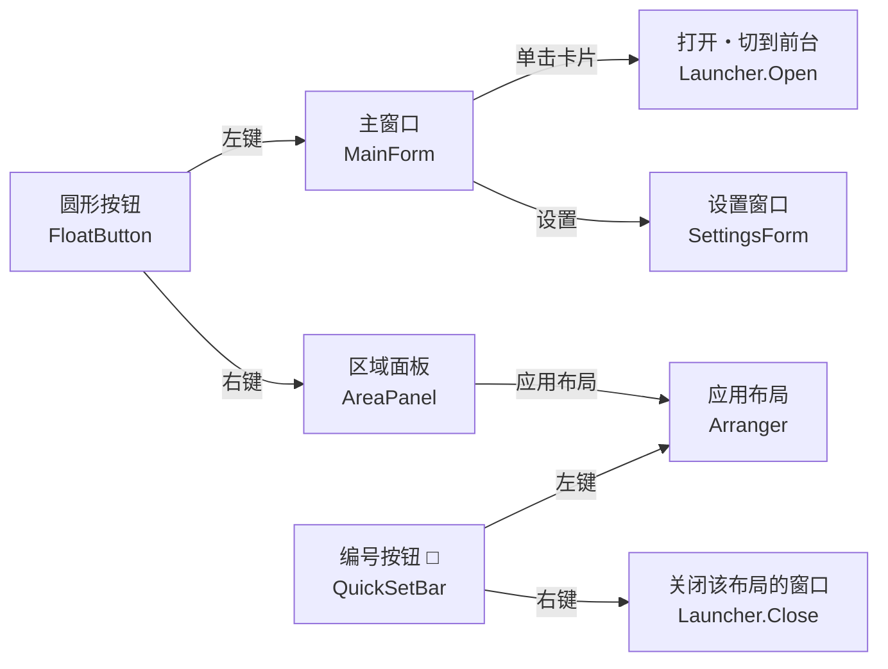
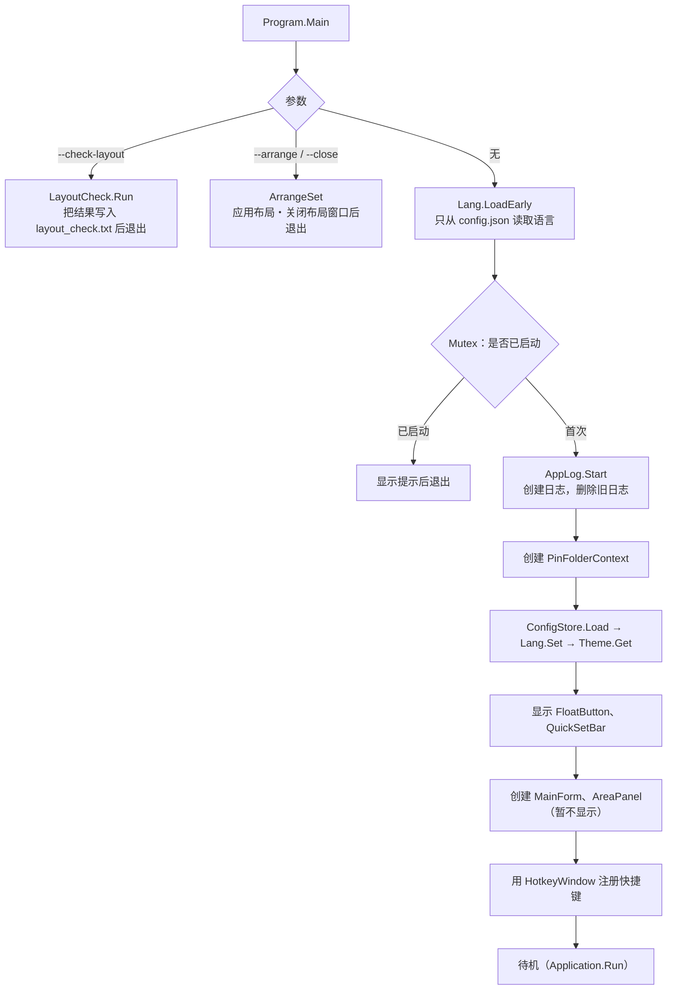
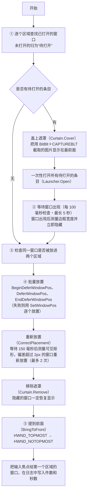

# PinFolder 技术说明（所用技术与源码地图）

本文面向一起阅读、修改 PinFolder 源码的同事，汇总所用技术和各文件的作用。使用方法和确认项目请参阅 README.md（日文）。本文是《技術まとめ.md》的中文译本，内容相同（另加“术语对照”表）。

| 项目 | 内容 |
|---|---|
| 对象版本 | PinFolder 0.1.0.0（AssemblyInfo.cs）。2026-11-25 的共享副本 |
| 对象文件 | 本文件夹中的 `src\*.cs`（28 个）、`src\app.manifest`、`build.bat`、`icon\` |
| 编写日期 | 2026-11-25 |

术语对照（与 src\Lang.cs 的中文译文一致）

| 日文（源码・注释） | 中文 | 说明 |
|---|---|---|
| グループ | 分组 | 把多个条目归为一组（例如一个项目） |
| 登録した物 | 条目 | 已添加的一个文件夹或一个应用 |
| 区画 | 区域 | 把屏幕均分后的一个格子 |
| セット | 布局 | 起了名字保存下来的“网格形状＋各区域的条目” |
| 配置を適用 | 应用布局 | 按布局打开窗口并排列到各区域 |
| 一式を閉じる | 关闭布局窗口 | 只关闭区域中条目的窗口 |
| 丸いボタン | 圆形按钮 | 浮在屏幕右下角的按钮 |
| 大きな画面 | 主窗口 | 左键单击圆形按钮打开的窗口 |
| 区画パネル | 区域面板 | 右键单击圆形按钮打开的窗口（标题为“PinFolder 布局”） |
| 幕 | 遮罩 | 应用布局期间盖在屏幕上的截图 |

---

## 1. 概述：这个工具做什么

PinFolder 常驻在 Windows 中，用来打开、排列已添加的文件夹和应用。主要功能如下表。

| 功能 | 内容 | 主要文件 |
|---|---|---|
| 圆形按钮 | 浮在屏幕右下角（任务栏上方）、带磁铁图案的圆形按钮。左键打开主窗口，右键打开区域面板。可拖动，并记住位置 | FloatButton.cs、PinFolderContext.cs |
| 添加与打开 | 把文件夹、应用（EXE）作为条目添加到分组。单击卡片即打开；如果已经打开，不再新开，而是把该窗口切到前台 | MainForm.cs、Launcher.cs、WindowFinder.cs |
| 区域布局 | 把屏幕分成 2×2、2×3、2×4（纵 2 行 × 横 2〜4 列）的区域，把条目放入区域，起名保存为布局 | AreaPanel.cs、Config.cs（LayoutSet、AreaShapes） |
| 应用布局 | 按布局打开窗口并排列到各区域。打开期间盖上遮罩，不让用户看到窗口一个个出现的过程 | Arranger.cs、Curtain.cs |
| 编号按钮 | 圆形按钮上方的 □（布局编号，最多 12 个）。左键应用该布局，右键关闭该布局的窗口 | QuickSetBar.cs、PatternBox.cs |
| 快捷键 | 在任何界面都有效的快捷键（默认：Ctrl+Alt+P 打开主窗口；Ctrl+Win+Alt+方向键 把前台窗口移到相邻区域）。每个条目也可以设置快捷键 | Hotkeys.cs、PinFolderContext.cs |
| 界面语言 | 在设置中切换日语、英语、中文（简体） | Lang.cs、SettingsForm.cs |

界面结构如下图。

---

## 2. 前提条件：运行环境

| 项目 | 内容 | 源码依据 |
|---|---|---|
| 操作系统 | Windows 10、11，Windows Server 2022 | README.md 的前提条件，app.manifest 的 supportedOS |
| 运行基础 | .NET Framework 4.8（上述系统自带） | build.bat 使用 `v4.0.30319\csc.exe` |
| 权限 | 不需要管理员权限（以当前用户权限运行） | app.manifest 的 `requestedExecutionLevel level="asInvoker"` |
| 外部组件 | 不使用外部库，只引用 .NET Framework 标准组件 | build.bat 的 `/reference`（System、System.Core、System.Drawing、System.Windows.Forms、System.Web.Extensions、Microsoft.CSharp） |
| 网络通信 | 不进行任何外部通信 | 源码中没有网络处理 |
| 分发内容 | 只有一个 `PinFolder.exe`。首次启动时在 exe 旁边生成 `config.json` | ConfigStore.Load（Config.cs） |
| 放置位置 | 放在可写入的文件夹（设置和日志写在 exe 旁边） | 使用 AppPaths.ExeDir 的 ConfigStore、AppLog |

---

## 3. 输入：参考资料

本文根据下列文件编写，均为本文件夹中的文件。

| 文件 | 阅读的部分 |
|---|---|
| README.md | 概述、前提条件、使用方法、确认项目、限制事项 |
| build.bat | csc.exe 的调用、引用、嵌入的图片 |
| src\app.manifest | 权限、支持的系统、缩放比例声明 |
| src\*.cs（28 个） | 各类开头的 `
`、主要方法、P/Invoke 声明 |
| icon\make-ico.ps1 | 图标的制作方法（开头注释） |

---

## 4. 所用技术

按领域列出所用技术如下表。每一项都在源码中确认过使用位置。

| 领域 | 技术 | 使用位置（文件） | 一句话理由 |
|---|---|---|---|
| 语言・界面 | C# 5 ＋ Windows Forms（WinForms） | 全部 src\*.cs | 只靠 .NET Framework 4.8 即可运行，无需额外安装 |
| 构建 | Windows 自带的 `csc.exe`（`%WINDIR%\Microsoft.NET\Framework64\v4.0.30319\`，找不到时用 32 位版） | build.bat | 不安装 Visual Studio 也能构建。该 csc.exe 只支持到 C# 5，因此不使用 C# 6 及以后的写法（`?.`、`$"..."`、`nameof` 等） |
| 构建 | 嵌入图片（`/resource`），指定图标和清单（`/win32icon`、`/win32manifest`） | build.bat、AppPaths.cs（GetManifestResourceStream）、FloatButton.cs | 为了只分发一个 exe，把圆形按钮和遮罩的图片放进 exe |
| Win32 API（P/Invoke） | RegisterHotKey、UnregisterHotKey、WM_HOTKEY | NativeMethods.cs、Hotkeys.cs（HotkeyWindow） | 让快捷键在任何界面下都有效 |
| Win32 API（P/Invoke） | BeginDeferWindowPos、DeferWindowPos、EndDeferWindowPos | NativeMethods.cs、Arranger.cs（PlaceAll） | 一次性批量放置多个窗口。无法批量放置时，用 SetWindowPos 逐个放置 |
| Win32 API（P/Invoke） | SetWindowPos（HWND_TOPMOST → HWND_NOTOPMOST 往返） | Arranger.cs（PlaceAll、CorrectPlacement、BringToFront） | 用于重新放置，以及把排好的窗口提到其他应用窗口之前 |
| Win32 API（P/Invoke） | DwmGetWindowAttribute（DWMWA_EXTENDED_FRAME_BOUNDS）、GetWindowRect | NativeMethods.cs、Arranger.cs（Border、VisibleBounds） | 扣除 Windows 10・11 窗口看不见的边框（阴影）宽度，使窗口在视觉上无缝排列 |
| Win32 API（P/Invoke） | UpdateLayeredWindow、WS_EX_LAYERED（GetDC、CreateCompatibleDC、SelectObject 等） | FloatButton.cs（ApplyLayeredBitmap） | 用半透明像素把圆形按钮的边缘画成平滑的圆 |
| Win32 API（P/Invoke） | BitBlt ＋ SRCCOPY、CAPTUREBLT | Curtain.cs（CaptureScreen） | 截取遮罩用的图片。加上 CAPTUREBLT，圆形按钮和 □ 也会被截进去（.NET 的 CopyFromScreen 不接受这个组合） |
| Win32 API（P/Invoke） | WS_EX_NOACTIVATE、WS_EX_TOOLWINDOW、WM_MOUSEACTIVATE（MA_NOACTIVATE） | Curtain.cs、QuickSetBar.cs、ToastForm.cs、FloatButton.cs | 点击时不抢输入焦点，也不出现在任务栏和 Alt+Tab 中 |
| Win32 API（P/Invoke） | EnumWindows、GetWindowText、GetWindowThreadProcessId、QueryFullProcessImageName、OpenProcess | NativeMethods.cs、WindowFinder.cs、Arranger.cs | 通过“exe 路径相同的进程的窗口”查找应用窗口 |
| Win32 API（P/Invoke） | SetForegroundWindow、ShowWindow（SW_RESTORE）、keybd_event（Alt 键）、PostMessage（WM_CLOSE） | WindowFinder.cs（Activate、CloseApp） | 把已打开的窗口切到前台（最小化的也会还原），关闭窗口 |
| Win32 API（P/Invoke） | SHGetFileInfo、DestroyIcon | NativeMethods.cs、Helpers.cs（IconCache） | 从 Windows 获取条目的小图标（16px） |
| Win32 API（P/Invoke） | SendMessage（EM_SETCUEBANNER） | Helpers.cs（Ui.SetCue） | 在输入框中显示浅色的提示示例 |
| COM | Shell.Application（用 `Windows()` 获取已打开的资源管理器窗口列表） | WindowFinder.cs（GetExplorerWindows） | 按文件夹路径找到已打开的文件夹窗口 |
| COM | WScript.Shell（创建快捷方式） | Helpers.cs（Startup） | 通过当前用户“启动”文件夹中的快捷方式实现开机常驻（不需要管理员权限） |
| COM 调用 | `dynamic`（引用 Microsoft.CSharp） | WindowFinder.cs、Helpers.cs | 不添加类型库引用即可调用 COM |
| 缩放比例 | PerMonitorV2（app.manifest 的 `dpiAwareness`） | src\app.manifest | 在每个显示器的缩放比例下文字都不模糊 |
| 缩放比例 | DpiWatcher（接收 WM_DPICHANGED，用 Control.Scale 和重建字体来适配；用 GetDpiForWindow 取得缩放比例） | DpiWatcher.cs（各窗口创建时调用 `DpiWatcher.Attach`） | 窗口移到缩放比例不同的显示器时，仍用一个 exe 适配大小和文字 |
| 绘制 | GDI+ 自绘（System.Drawing） | FloatButton.cs、PatternBox.cs、ZoneTile.cs、Curtain.cs、Theme.cs、MainForm.cs（卡片、搜索框） | 用标准控件做不到的外观绘制圆形按钮、□、区域卡片等 |
| 外观 | 3 种样式（office 标准办公、steel 钢制工具箱、memo 紧凑桌面便签） | Theme.cs（在 Control.Tag 中写入角色，按角色上色） | 在设置的“常规”中切换 |
| 设置 | 用 JavaScriptSerializer（System.Web.Extensions）读写 config.json | Config.cs（ConfigStore） | 只用标准组件处理 JSON |
| 设置 | 先写入临时文件（`config.json.tmp`），再用 File.Replace 替换。读取失败时保留备份（`.bak`），以新设置运行 | Config.cs（ConfigStore.Save、Load） | 写入中途中断也不会损坏设置 |
| 日志 | to_ai_log 中的 Markdown（`pinfolder_resident_YYYYMMDD_HHmmss.md`）。启动一次＝一个文件，启动时删除超过 12 个月的文件。出错时写明“停在哪里・原因・下一步做什么” | AppLog.cs（Start、Info、Warn、Error、End、DeleteOldFiles） | 只要把日志文件交给生成式 AI，就能知道可能的原因和下一步操作 |
| 语言 | Lang.cs：以日文句子为键的词典（`Lang.T("保存")`，带参数的用 `Lang.F`）。词典中没有的句子按日文原样显示 | Lang.cs、所有界面文件 | 把译文集中在一个文件，界面源码保持日文可读 |
| 语言 | 按语言切换字体（日语 Yu Gothic UI、英语 Segoe UI、中文 Microsoft YaHei UI） | Lang.cs（FontName）、Theme.cs | 使用字形齐全的 Windows 自带字体 |
| 防止重复启动 | Mutex（`Local\PinFolder_SingleInstance`） | Program.cs | 同一用户会话中不启动两个 |
| 自检 | `--check-layout`：不显示界面，按 3 种语言 × 5 档缩放（100〜200%）× 3 种外观 × 6 个窗口（编辑条目、添加分组、设置、主窗口、区域面板、输入名称）创建并检查 | LayoutCheck.cs、Program.cs | 不靠人眼即可确认按钮不会因分辨率、缩放、语言而被遮挡或截断 |
| 命令 | `--arrange "布局名称"`、`--close "布局名称"` | Program.cs（ArrangeSet） | 通过桌面快捷方式，即使未常驻也能应用布局、关闭布局窗口 |

---

## 5. 文件地图

`src` 中各文件的作用如下表。作用依据各文件开头的 `
` 和主要方法确认。

| 分类 | 文件 | 主要类 | 作用 |
|---|---|---|---|
| 入口・主体 | Program.cs | Program | 入口。分派参数（`--check-layout`、`--arrange`、`--close`），用 Mutex 防止重复启动并开始常驻 |
| 入口・主体 | PinFolderContext.cs | PinFolderContext | 常驻主体。统管圆形按钮、编号按钮、主窗口、区域面板、快捷键、设置、通知 |
| 入口・主体 | AssemblyInfo.cs | （仅特性） | exe 的名称、说明、版本（0.1.0.0） |
| 入口・主体 | AppPaths.cs | AppPaths | 应用名称、exe 位置、版本，读取嵌入的图标和图片 |
| 界面 | FloatButton.cs | FloatButton | 右下角的圆形按钮。两张窗口图片浮在磁铁上方，悬停或打开时有吸附动画 |
| 界面 | QuickSetBar.cs | QuickSetBar | 圆形按钮上方的编号按钮 □（最多 12 个，每行 4 个）以及显示・隐藏箭头 |
| 界面 | PatternBox.cs | PatternBox | 绘制一个编号按钮 □ 或箭头 |
| 界面 | MainForm.cs | MainForm | 主窗口。左侧为分组列表，右侧为条目卡片。可拖入或用［+ 添加文件夹］添加 |
| 界面 | AreaPanel.cs | AreaPanel | 区域面板。选择网格形状，从“已添加条目”拖入区域，［应用布局］［关闭布局窗口］，保存布局 |
| 界面 | ZoneTile.cs | ZoneTile | 绘制区域面板中的一个区域（有条目的区域・空区域） |
| 界面 | SettingsForm.cs | SettingsForm | 设置窗口（“快捷键”“常规”两个标签页。常规中有开机常驻、语言、外观、日志文件夹） |
| 界面 | EntryForm.cs | EntryForm | 编辑条目的子窗口（类型、显示名称、位置、参数、快捷键） |
| 界面 | JobForm.cs | JobForm | 添加分组・重命名分组的子窗口 |
| 界面 | NameForm.cs | NameForm | 输入一个名称的子窗口（布局的［另存为］） |
| 界面 | ToastForm.cs | ToastForm | 在圆形按钮上方显示几秒的通知（快捷键不可用、文件夹不存在等） |
| 界面 | Curtain.cs | Curtain | 应用布局期间盖在目标屏幕上的遮罩（截图＋中央的磁铁图案。最长 8 秒后自动移除） |
| 界面公共 | Theme.cs | Theme、UiTags | 3 种外观样式，以及给控件上色、设字体的方法 |
| 界面公共 | DpiWatcher.cs | DpiWatcher | 按各显示器的缩放比例重建控件和文字大小 |
| 界面公共 | Helpers.cs | IconCache、Startup、Ui、IFitDialog | 条目图标，开机常驻（“启动”文件夹的快捷方式），创建控件的小工具（按 96dpi 编写，按缩放比例放大） |
| 界面公共 | Lang.cs | Lang | 界面语言词典（日语、英语、中文（简体））和各语言的字体 |
| 处理 | Arranger.cs | Arranger、ArrangeResult | 计算区域矩形，把窗口排列到区域（应用布局）。把前台窗口移到相邻区域 |
| 处理 | Launcher.cs | Launcher、OpenResult | 打开条目（已打开则切到前台）・关闭 |
| 处理 | WindowFinder.cs | WindowFinder、ExplorerWindow、OpenSnapshot | 查找・切到前台・关闭已打开的窗口（文件夹用 Shell.Application，应用用进程的 exe 路径） |
| 处理 | Hotkeys.cs | HotkeyText、HotkeyWindow、HotkeyBox | 快捷键文字与注册值的转换，接收 RegisterHotKey 的隐藏窗口，按键即可录入的输入框 |
| 设置・日志 | Config.cs | AppConfig、Job、Entry、LayoutSet、ScreenTargets、AreaShapes、ConfigStore | 设置的结构（分组、条目、布局），目标屏幕的决定方法，网格形状，config.json 的读写 |
| 设置・日志 | AppLog.cs | AppLog | 交给生成式 AI 的日志（to_ai_log 中的 Markdown） |
| Windows 调用 | NativeMethods.cs | NativeMethods | user32、kernel32、shell32、dwmapi 调用的声明和常量 |
| 自检 | LayoutCheck.cs | LayoutCheck | `--check-layout` 的实现。结果写入 layout_check.txt |
| 声明 | app.manifest | — | 不要求管理员权限、支持 Windows 10/11、PerMonitorV2 |

`src` 以外的文件如下表。

| 文件 | 作用 |
|---|---|
| build.bat | 生成 `bin\PinFolder.exe`（日志为 `logs\build_YYYYMMDD_HHMMSS.log`） |
| icon\PinFolder.ico | exe 的图标 |
| icon\float_magnet.png | 遮罩中央的磁铁图片（嵌入 exe） |
| icon\float_parts\magnet.png、window_card.png | 圆形按钮的磁铁和窗口图片部件（嵌入 exe） |
| icon\magnet_16.svg、magnet_48.svg、render.html、make-ico.ps1 | 图标的原图，以及用 Edge 截图并生成 ico 的工具 |
| .gitignore | 不提交构建生成的 `bin/`、`logs/` |

---

## 6. 处理流程

### 6.1 从启动到待机

启动流程如下图。

### 6.2 圆形按钮・编号按钮的操作

操作与被调用的处理如下表。

| 操作 | 被调用的处理（PinFolderContext） | 后续 |
|---|---|---|
| 左键单击圆形按钮 | ToggleMain | 显示・隐藏 MainForm |
| 右键单击圆形按钮 | ToggleArea | 显示・隐藏 AreaPanel |
| 拖动圆形按钮 | Moved 事件处理 | 把位置保存到 config.json，把 □ 移到圆形按钮正上方 |
| 左键单击编号按钮 □ | ApplySet | Arrange → Arranger.Arrange（目标屏幕为圆形按钮所在的屏幕） |
| 右键单击编号按钮 □ | CloseSet | CloseZones → Launcher.Close（只关闭该布局各区域中条目的窗口） |
| 单击卡片・条目的快捷键 | OpenEntry | Launcher.Open（已打开则切到前台） |
| Ctrl+Win+Alt+方向键 | MoveForeground | Arranger.MoveForeground（按最近一次应用布局的网格形状移到相邻区域） |

排列期间（`_arranging` 为 true 时）不接受其他操作。这是为了防止在等待窗口出现时被其他操作打断，导致排列混乱。

### 6.3 应用布局（Arranger.Arrange）

应用布局的流程如下图。

【补充】区域是把屏幕工作区（不含任务栏的部分）按“横向列数 × 纵向 2 行”均分得到的矩形（Arranger.ZoneBounds）。窗口外框含有看不见的边框（阴影），因此放置时加上与 DwmGetWindowAttribute 测得的可见矩形之间的差值。

【补充】即使中途出错，也会在 `finally` 中恢复显示隐藏的窗口并移除遮罩。即使忘记移除，Curtain 也会在 8 秒后自动关闭。

---

## 7. 输出：构建与验证方法

构建与验证的步骤及产物如下表。

| 步骤 | 操作 | 产物・结果 |
|---|---|---|
| 构建 | 双击 `build.bat`（PinFolder 运行期间无法构建，请先退出） | `bin\PinFolder.exe`、`logs\build_YYYYMMDD_HHMMSS.log`（最后一行为退出码：0＝成功，1＝构建错误，2＝找不到 csc.exe） |
| 界面尺寸检查 | 执行 `bin\PinFolder.exe --check-layout`（不显示界面） | exe 旁边的 `layout_check.txt`（NG 行写明哪个窗口的哪个按钮）、`layout_shots`（各语言的界面截图）、to_ai_log 日志。退出码 0＝全部可达，1＝有不可达・被截断的按钮，2＝检查本身失败 |
| 应用・关闭布局 | `bin\PinFolder.exe --arrange "布局名称"`、`--close "布局名称"` | 退出码 0＝成功，1＝有未能打开的条目，2＝布局不存在・失败。详情写入日志 |
| 运行确认 | 启动 `bin\PinFolder.exe` | exe 旁边生成 `config.json` 和 `to_ai_log\pinfolder_resident_YYYYMMDD_HHmmss.md` |

- 修改界面后，构建完成再运行 `--check-layout`
- `--arrange`、`--close` 的目标屏幕是 config.json 中保存的圆形按钮位置所在的屏幕（Program.ArrangeSet → ScreenTargets.ForButton）

---

## 8. 处理规则：共同修改时的规则

修改源码时的规则如下表。全部为必须遵守。

| 规则 | 内容 | 正确示例 | 错误示例 |
|---|---|---|---|
| 只用到 C# 5 | build.bat 的 csc.exe 只能编译到 C# 5 | `if (form != null) { form.Close(); }`、`string.Format("{0} 件", count)` | `form?.Close();`、`$"{count} 件"`、`nameof(x)` |
| 注释用日文 | 类和公开方法加日文 `
` | `/// 
登録した物を開く。
` | `// open entry` |
| 界面上不写操作说明 | 通过项目名、按钮名、错误提示让人看懂 | 按钮名［配置を適用］ | “点这里就会排列”这样的说明标签 |
| 界面文字经过 Lang.T | 新句子要连同英文、中文译文一起加入 Lang.cs 词典 | `Lang.T("保存")`、`Lang.F("「{0}」に {1} 件を登録しました", name, count)` | `button.Text = "保存";` |
| 日志保持日文 | 传给 AppLog 的文字不经过 Lang.T（因为要交给生成式 AI） | `AppLog.Warn("開く", target, "フォルダがありません", "…確かめてください")` | `AppLog.Warn(Lang.T("開く"), …)` |
| 魔法数字用常量 | 时间、尺寸、次数用具名常量 | `private const int OpenWaitMilliseconds = 5000;` | `Thread.Sleep(5000);` |
| 不吞掉异常 | catch 后用 AppLog.Error（或 Warn）写到“下一步做什么” | `catch (Exception ex) { AppLog.Error("設定の保存", path, ex, "exe のフォルダに書き込めるか…"); }` | `catch { }` |

【例外】只有在日志开始之前（Lang.LoadEarly）无法写日志，因此不记录、按日文继续。读取设置时会再次记录。

---

## 9. 限制事项

从 README.md 的限制事项中，摘出修改源码的人需要知道的要点如下表。

| 分类 | 限制 |
|---|---|
| 资源管理器 | 无法通过程序切换标签页。能切到前台的只到窗口为止 |
| 资源管理器 | Win11 中两个文件夹作为标签页在同一个窗口里时，不能放进两个区域（后一个区域保持空。请在单独的窗口中打开） |
| 应用 | 同一个 EXE 已在运行时，把它的窗口切到前台（不会启动两个同一 EXE） |
| 权限 | 无法移动以管理员权限运行的窗口 |
| 放置位置 | 把 exe 放在不可写入的位置（Program Files 等）时，无法写入设置和日志 |
| 缩放比例 | 各显示器缩放比例不同时，窗口移到其他显示器后 PinFolder 会自行重建大小和文字。右键菜单、提示标签、选择文件的窗口在副显示器上可能大小不合适 |
| 遮罩 | 遮罩只盖在目标屏幕上。资源管理器在其他屏幕上出窗口时，或总在最前的应用窗口，可能在隐藏前一闪而过。遮罩最长 8 秒后自动移除 |
| 语言 | 切换界面语言后，日志（to_ai_log）仍为日文。用户起的名字（条目名称、布局名称等）不翻译 |
| 未实现 | STEP3（启动 VS Code、Claude Code）尚未实现 |
| 未确认 | 是否会被杀毒软件拦截，以及能否在普通用户权限・不联网的终端上运行，在 README 的确认项目中为“未” |

---

## 附录 A. 阅读源码时发现的问题（未修改）

阅读源码时发现的注释与实际行为不一致之处如下表。本文按实际行为（代码）编写。

| 文件 | 注释中的写法 | 代码的实际行为 |
|---|---|---|
| Program.cs | 类的 `
` 写着“开始在通知区域常驻” | 没有通知区域图标，以圆形按钮（FloatButton）常驻 |
| Program.cs | ArrangeSet 的 `
` 写着“排列到鼠标所在的屏幕” | 排列到圆形按钮位置所在的屏幕（ScreenTargets.ForButton） |
| EntryForm.cs | `
` 写着“从设置窗口的［添加］［编辑］打开” | 条目在主窗口中添加，由 MainForm 的 EditEntry 打开（SettingsForm 的 `
` 也写着“条目在主窗口中添加”） |
| Program.cs、app.manifest | Program.cs 调用 SetProcessDPIAware | app.manifest 已声明 PerMonitorV2，因此实际生效的应是清单的声明（待确认） |
