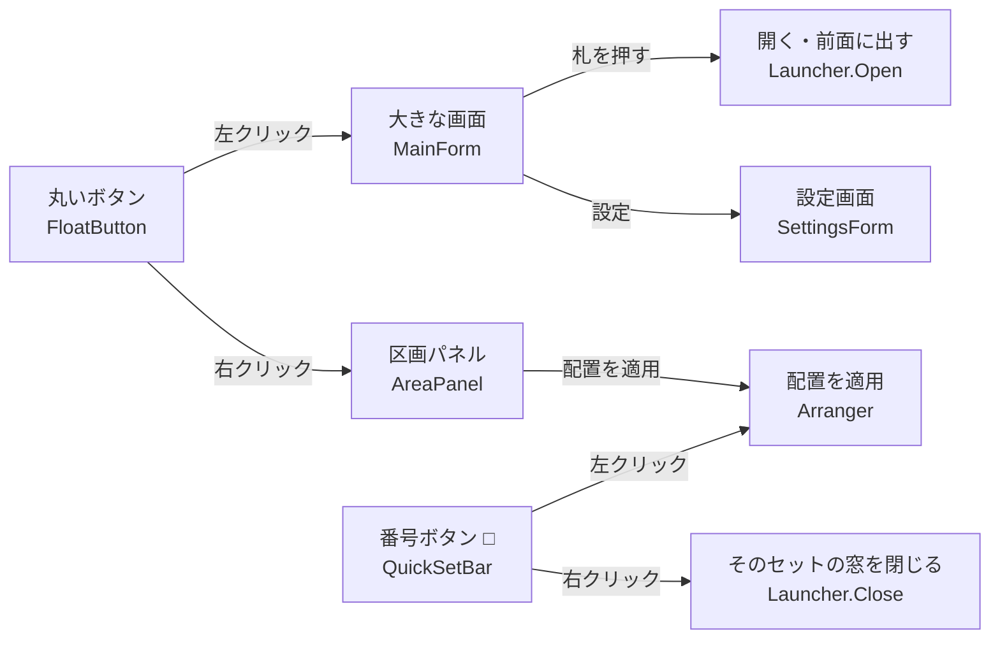
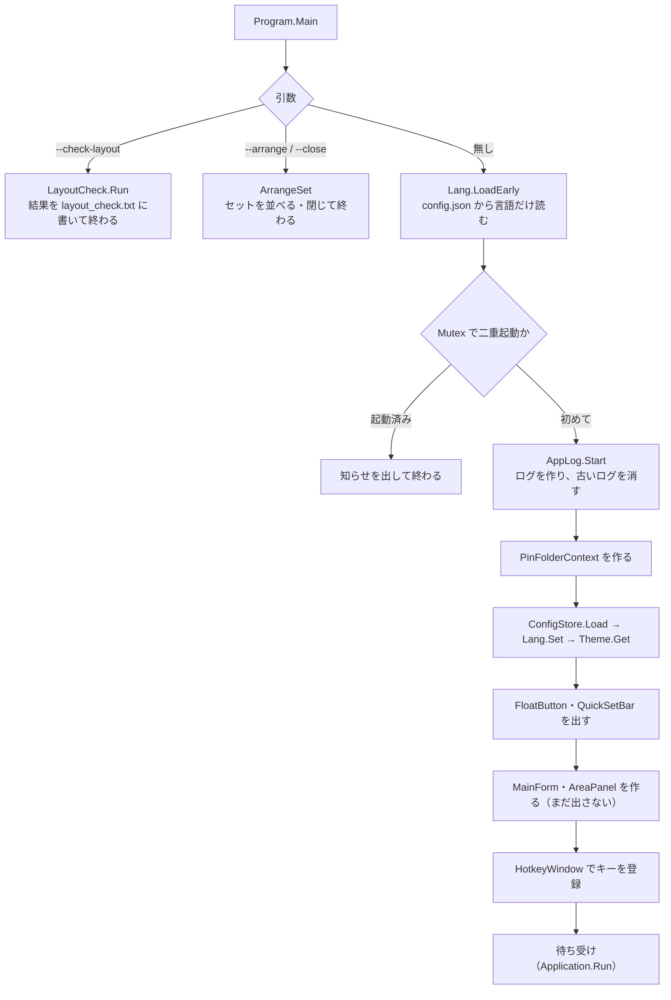
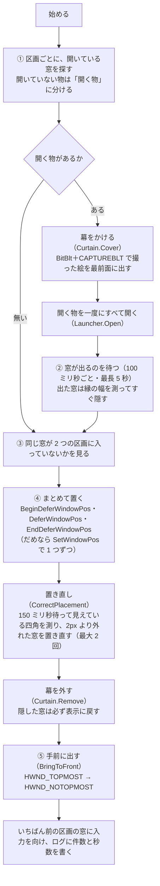

# PinFolder 技術まとめ（使った技術とソースの地図）

PinFolder のソースを一緒に読む・直す人のために、使った技術とファイルの役割をまとめた説明書です。使い方・確認項目は README.md を見てください。

| 項目 | 内容 |
|---|---|
| 対象の版 | PinFolder 0.1.0.0（AssemblyInfo.cs）。2026-11-25 の共有用の写し |
| 対象のファイル | このフォルダの `src\*.cs`（28 本）・`src\app.manifest`・`build.bat`・`icon\` |
| 書いた日 | 2026-11-25 |

---

## 1. 概要：何をするツールか

PinFolder は、Windows に常駐し、登録したフォルダ・アプリを開いたり並べたりする道具です。主な機能を次の表に示します。

| 機能 | 中身 | 主なファイル |
|---|---|---|
| 丸いボタン | 画面の右下（タスクバーの上）に浮かぶ、磁石の絵の丸いボタン。左クリックで大きな画面、右クリックで区画パネルを開く。ドラッグで動かせ、置いた場所を覚える | FloatButton.cs・PinFolderContext.cs |
| 登録と開く | フォルダ・アプリ（EXE）をグループに登録する。札を押すと開く。既に開いていれば、新しく開かずにその窓を前面に出す | MainForm.cs・Launcher.cs・WindowFinder.cs |
| 区画のセット | 画面を 2×2・2×3・2×4（縦 2 段 × 横 2〜4 列）の区画に割り、区画に登録した物を入れて名前を付けて残す（セット） | AreaPanel.cs・Config.cs（LayoutSet・AreaShapes） |
| 配置を適用 | セットのとおりに窓を開いて区画へ並べる。開く間は幕をかけ、窓が 1 つずつ出る過程を見せない | Arranger.cs・Curtain.cs |
| 番号ボタン | 丸いボタンの上の □（セットの番号。最大 12）。左クリックでそのセットを並べ、右クリックでそのセットの窓を閉じる | QuickSetBar.cs・PatternBox.cs |
| キー | どの画面からでも効くキー（初期値は Ctrl+Alt+P で大きな画面、Ctrl+Win+Alt+矢印で手前の窓を隣の区画へ）。登録した物ごとにもキーを付けられる | Hotkeys.cs・PinFolderContext.cs |
| 画面の言葉 | 日本語・英語・中国語（簡体）を設定画面で切り替える | Lang.cs・SettingsForm.cs |

画面の構成を次の図に示します。

---

## 2. 前提条件：動く環境

| 項目 | 内容 | ソースでの根拠 |
|---|---|---|
| OS | Windows 10・11、Windows Server 2022 | README.md の前提条件、app.manifest の supportedOS |
| 実行の基盤 | .NET Framework 4.8（上の OS に最初から入っている） | build.bat が `v4.0.30319\csc.exe` を使う |
| 権限 | 管理者権限は要らない（利用者の権限で動く） | app.manifest の `requestedExecutionLevel level="asInvoker"` |
| 外部の部品 | 外部ライブラリは使わない。参照は .NET Framework の標準の部品だけ | build.bat の `/reference`（System・System.Core・System.Drawing・System.Windows.Forms・System.Web.Extensions・Microsoft.CSharp） |
| 通信 | 外部への通信はしない | ネットワークの処理はソースに無い |
| 配る物 | `PinFolder.exe` 1 つ。`config.json` は初めの起動で exe の横に作られる | ConfigStore.Load（Config.cs） |
| 置き場所 | exe を書き込める場所に置く（設定とログを exe の横に書くため） | AppPaths.ExeDir を使う ConfigStore・AppLog |

---

## 3. 入力：参照した資料

この文書は、次のファイルを読んで書きました。どれも、このフォルダの中のファイルです。

| ファイル | 読んだ所 |
|---|---|
| README.md | 概要・前提条件・使い方・確認項目・制約事項 |
| build.bat | csc.exe の呼び出し・参照・埋め込む絵 |
| src\app.manifest | 権限・対応 OS・画面の倍率の宣言 |
| src\*.cs（28 本） | 各クラスの先頭の `
`、主なメソッド、P/Invoke の宣言 |
| icon\make-ico.ps1 | アイコンの作り方（先頭のコメント） |

---

## 4. 使った技術

使った技術を分野ごとに次の表に示します。どれもソースで使っている所を確かめました。

| 分野 | 技術 | 使っている所（ファイル） | ひと言の理由 |
|---|---|---|---|
| 言語・画面 | C# 5 ＋ Windows Forms（WinForms） | src\*.cs すべて | .NET Framework 4.8 だけで動き、追加の導入が要らない |
| ビルド | Windows 標準の `csc.exe`（`%WINDIR%\Microsoft.NET\Framework64\v4.0.30319\`。無ければ 32bit 版） | build.bat | Visual Studio を入れずにビルドできる。この csc.exe は C# 5 までのため、C# 6 以降の書き方（`?.`・`$"..."`・`nameof` など）は使わない |
| ビルド | 絵の埋め込み（`/resource`）とアイコン・マニフェストの指定（`/win32icon`・`/win32manifest`） | build.bat・AppPaths.cs（GetManifestResourceStream）・FloatButton.cs | exe 1 つで配れるよう、丸いボタンと幕の絵を exe に入れる |
| Win32 API（P/Invoke） | RegisterHotKey・UnregisterHotKey・WM_HOTKEY | NativeMethods.cs・Hotkeys.cs（HotkeyWindow） | どの画面を使っていても効くキーにする |
| Win32 API（P/Invoke） | BeginDeferWindowPos・DeferWindowPos・EndDeferWindowPos | NativeMethods.cs・Arranger.cs（PlaceAll） | 複数の窓を一度にまとめて置く。まとめて置けない時は SetWindowPos で 1 つずつ置く |
| Win32 API（P/Invoke） | SetWindowPos（HWND_TOPMOST → HWND_NOTOPMOST の往復） | Arranger.cs（PlaceAll・CorrectPlacement・BringToFront） | 置き直しと、並べた窓をほかのアプリの窓より手前に出すため |
| Win32 API（P/Invoke） | DwmGetWindowAttribute（DWMWA_EXTENDED_FRAME_BOUNDS）・GetWindowRect | NativeMethods.cs・Arranger.cs（Border・VisibleBounds） | Windows 10・11 の窓の見えない縁（影）の幅を差し引き、見た目ですき間なく並べる |
| Win32 API（P/Invoke） | UpdateLayeredWindow・WS_EX_LAYERED（GetDC・CreateCompatibleDC・SelectObject など） | FloatButton.cs（ApplyLayeredBitmap） | 丸いボタンの縁を、半透明の画素でなめらかな円にする |
| Win32 API（P/Invoke） | BitBlt ＋ SRCCOPY・CAPTUREBLT | Curtain.cs（CaptureScreen） | 幕の絵を撮る。CAPTUREBLT を付けると、丸いボタン・□ も絵に入る（.NET の CopyFromScreen はこの組み合わせを受け付けない） |
| Win32 API（P/Invoke） | WS_EX_NOACTIVATE・WS_EX_TOOLWINDOW・WM_MOUSEACTIVATE（MA_NOACTIVATE） | Curtain.cs・QuickSetBar.cs・ToastForm.cs・FloatButton.cs | 押しても入力の向きを奪わず、タスクバー・Alt+Tab に出さない |
| Win32 API（P/Invoke） | EnumWindows・GetWindowText・GetWindowThreadProcessId・QueryFullProcessImageName・OpenProcess | NativeMethods.cs・WindowFinder.cs・Arranger.cs | アプリの窓を、exe の場所が同じプロセスの窓で探す |
| Win32 API（P/Invoke） | SetForegroundWindow・ShowWindow（SW_RESTORE）・keybd_event（Alt キー）・PostMessage（WM_CLOSE） | WindowFinder.cs（Activate・CloseApp） | 開いている窓を前面に出す（最小化からも戻す）、窓を閉じる |
| Win32 API（P/Invoke） | SHGetFileInfo・DestroyIcon | NativeMethods.cs・Helpers.cs（IconCache） | 登録した物の小さなアイコン（16px）を Windows から取る |
| Win32 API（P/Invoke） | SendMessage（EM_SETCUEBANNER） | Helpers.cs（Ui.SetCue） | 入力欄に薄い字の見本を出す |
| COM | Shell.Application（`Windows()` で開いているエクスプローラーの窓の一覧） | WindowFinder.cs（GetExplorerWindows） | 開いているフォルダの窓を、フォルダの場所で見つける |
| COM | WScript.Shell（ショートカットを作る） | Helpers.cs（Startup） | 起動時の常駐を、利用者のスタートアップのフォルダのショートカットで行う（管理者権限が要らない） |
| COM の呼び出し | `dynamic`（Microsoft.CSharp を参照） | WindowFinder.cs・Helpers.cs | 型ライブラリを参照に足さずに COM を呼ぶ |
| 画面の倍率 | PerMonitorV2（app.manifest の `dpiAwareness`） | src\app.manifest | 画面ごとの倍率で文字がぼやけないようにする |
| 画面の倍率 | DpiWatcher（WM_DPICHANGED を受け、Control.Scale と文字の作り直しで合わせる。GetDpiForWindow で倍率を取る） | DpiWatcher.cs（各画面の作成時に `DpiWatcher.Attach`） | 倍率の違う画面へ動かした時に、exe 1 つのまま大きさと文字を合わせる |
| 描画 | GDI+ の自前描画（System.Drawing） | FloatButton.cs・PatternBox.cs・ZoneTile.cs・Curtain.cs・Theme.cs・MainForm.cs（札・検索の欄） | 丸いボタン・□・区画の札などを、標準の部品にない見た目で描く |
| 見た目 | スタイル 3 つ（office 標準オフィス・steel スチール道具箱・memo コンパクト卓上メモ） | Theme.cs（Control.Tag に役割を入れ、色を当てる） | 設定画面の「全般」で切り替える |
| 設定 | JavaScriptSerializer（System.Web.Extensions）で config.json を読み書き | Config.cs（ConfigStore） | 標準の部品だけで JSON を扱う |
| 設定 | 一時ファイル（`config.json.tmp`）に書いてから File.Replace で置き換える。読めない時は控え（`.bak`）を残して新しい設定で動く | Config.cs（ConfigStore.Save・Load） | 書く途中で止まっても設定が壊れない |
| ログ | to_ai_log の Markdown（`pinfolder_resident_YYYYMMDD_HHmmss.md`）。起動 1 回＝1 ファイル、12 か月を過ぎたファイルは起動時に消す。誤りの時は「止まった所・理由・次にすること」を書く | AppLog.cs（Start・Info・Warn・Error・End・DeleteOldFiles） | ログのファイルを生成 AI に渡すだけで、原因の候補と次にすることが分かるようにする |
| 言語 | Lang.cs：日本語の文を鍵にした辞書（`Lang.T("保存")`・差し込みは `Lang.F`）。辞書に無い文は日本語のまま出す | Lang.cs・画面のファイルすべて | 訳を 1 つのファイルに集め、画面のソースは日本語のまま読めるようにする |
| 言語 | 書体を言語ごとに替える（日本語 Yu Gothic UI・英語 Segoe UI・中国語 Microsoft YaHei UI） | Lang.cs（FontName）・Theme.cs | その言語の字形がそろった Windows 標準の書体を使う |
| 二重起動の防止 | Mutex（`Local\PinFolder_SingleInstance`） | Program.cs | 同じ利用者のセッションで 2 つ起動しない |
| 自己検査 | `--check-layout`：3 言語 × 倍率 5 段階（100〜200%）× 見た目 3 つ × 画面 6 つ（登録の編集・グループの追加・設定・大きな画面・区画パネル・名前の入力）を、画面を出さずに作って調べる | LayoutCheck.cs・Program.cs | 解像度・倍率・言語でボタンが隠れたり切れたりしないかを、人の目で見ずに確かめる |
| コマンド | `--arrange "セットの名前"`・`--close "セットの名前"` | Program.cs（ArrangeSet） | デスクトップのショートカットから、常駐していなくても並べる・閉じる |

---

## 5. ファイルの地図

`src` の各ファイルの役割を次の表に示します。役割は各ファイルの先頭の `
` と主なメソッドで確かめました。

| 分類 | ファイル | 主なクラス | 役割 |
|---|---|---|---|
| 入口・本体 | Program.cs | Program | 入口。引数（`--check-layout`・`--arrange`・`--close`）を振り分け、Mutex で二重起動を防いで常駐を始める |
| 入口・本体 | PinFolderContext.cs | PinFolderContext | 常駐の本体。丸いボタン・番号ボタン・大きな画面・区画パネル・キー・設定・知らせをまとめる |
| 入口・本体 | AssemblyInfo.cs | （属性だけ） | exe の名前・説明・版（0.1.0.0） |
| 入口・本体 | AppPaths.cs | AppPaths | アプリの名前・exe の場所・版、埋め込んだアイコンと絵の読み込み |
| 画面 | FloatButton.cs | FloatButton | 右下に浮かぶ丸いボタン。磁石の上で 2 枚の窓の絵が浮き、ホバーや開いた時に吸い付く動き |
| 画面 | QuickSetBar.cs | QuickSetBar | 丸いボタンの上の番号ボタン □（最大 12、横 4 つずつ）と、出す・隠すの矢印 |
| 画面 | PatternBox.cs | PatternBox | 番号ボタン □ と矢印 1 つ分の描画 |
| 画面 | MainForm.cs | MainForm | 大きな画面。左にグループの一覧、右に登録した物の札。引っぱって入れる・［＋ フォルダを追加］で登録する |
| 画面 | AreaPanel.cs | AreaPanel | 区画パネル。形を選び、「登録した物」から区画へ引っぱって入れ、［配置を適用］［一式を閉じる］、セットの保存 |
| 画面 | ZoneTile.cs | ZoneTile | 区画パネルの区画 1 つの描画（入っている区画・空いた区画） |
| 画面 | SettingsForm.cs | SettingsForm | 設定画面（タブ「キー」「全般」。全般で起動時の常駐・言語・見た目・ログの場所） |
| 画面 | EntryForm.cs | EntryForm | 登録の編集の子画面（種類・表示名・場所・引数・ホットキー） |
| 画面 | JobForm.cs | JobForm | グループの追加・名前の変更の子画面 |
| 画面 | NameForm.cs | NameForm | 名前を 1 つ入れる子画面（セットの［別名で保存］） |
| 画面 | ToastForm.cs | ToastForm | 丸いボタンの上に数秒だけ出る知らせ（キーが使えない・フォルダが無いなど） |
| 画面 | Curtain.cs | Curtain | 配置を適用する間、並べる先の画面にかける幕（撮った絵＋真ん中の磁石。最長 8 秒で自分で外れる） |
| 画面の共通 | Theme.cs | Theme・UiTags | 見た目のスタイル 3 つと、部品への色・書体の当て方 |
| 画面の共通 | DpiWatcher.cs | DpiWatcher | 画面ごとの倍率に合わせて、部品と文字の大きさを作り直す |
| 画面の共通 | Helpers.cs | IconCache・Startup・Ui・IFitDialog | 登録した物のアイコン、起動時の常駐（スタートアップのショートカット）、部品を作る小さな道具（96dpi の値で書いて倍率で広げる） |
| 画面の共通 | Lang.cs | Lang | 画面の言葉の辞書（日本語・英語・中国語（簡体））と言語ごとの書体 |
| 処理 | Arranger.cs | Arranger・ArrangeResult | 区画の四角を求め、窓を区画へ並べる（配置を適用）。手前の窓を隣の区画へ動かす |
| 処理 | Launcher.cs | Launcher・OpenResult | 登録した物を開く（開いていれば前面に出す）・閉じる |
| 処理 | WindowFinder.cs | WindowFinder・ExplorerWindow・OpenSnapshot | 開いている窓を探す・前面に出す・閉じる（フォルダは Shell.Application、アプリはプロセスの exe の場所） |
| 処理 | Hotkeys.cs | HotkeyText・HotkeyWindow・HotkeyBox | キーの文字と登録する値の変換、RegisterHotKey を受ける見えない窓、キーを押して入れる欄 |
| 設定・ログ | Config.cs | AppConfig・Job・Entry・LayoutSet・ScreenTargets・AreaShapes・ConfigStore | 設定の形（グループ・登録した物・セット）、並べる先の画面の決め方、区画の形、config.json の読み書き |
| 設定・ログ | AppLog.cs | AppLog | 生成 AI に渡すログ（to_ai_log の Markdown） |
| Windows の呼び出し | NativeMethods.cs | NativeMethods | user32・kernel32・shell32・dwmapi の呼び出しの宣言と定数 |
| 自己検査 | LayoutCheck.cs | LayoutCheck | `--check-layout` の中身。結果を layout_check.txt に書く |
| 宣言 | app.manifest | — | 管理者権限を求めない・Windows 10/11 対応・PerMonitorV2 |

`src` の外のファイルを次の表に示します。

| ファイル | 役割 |
|---|---|
| build.bat | `bin\PinFolder.exe` を作る（ログは `logs\build_YYYYMMDD_HHMMSS.log`） |
| icon\PinFolder.ico | exe のアイコン |
| icon\float_magnet.png | 幕の真ん中の磁石の絵（exe に埋め込む） |
| icon\float_parts\magnet.png・window_card.png | 丸いボタンの磁石と窓の絵の部品（exe に埋め込む） |
| icon\magnet_16.svg・magnet_48.svg・render.html・make-ico.ps1 | アイコンの元の絵と、Edge で撮って ico にする道具 |
| .gitignore | ビルドで作る `bin/`・`logs/` を登録しない |

---

## 6. 処理の流れ

### 6.1 起動から待ち受けまで

起動の流れを次の図に示します。

### 6.2 丸いボタン・番号ボタンの操作

操作と呼ばれる処理を次の表に示します。

| 操作 | 呼ばれる処理（PinFolderContext） | その先 |
|---|---|---|
| 丸いボタンを左クリック | ToggleMain | MainForm を出す・隠す |
| 丸いボタンを右クリック | ToggleArea | AreaPanel を出す・隠す |
| 丸いボタンをドラッグ | Moved の受け手 | 位置を config.json に残し、□ を丸いボタンの真上へ動かす |
| 番号ボタン □ を左クリック | ApplySet | Arrange → Arranger.Arrange（並べる先は丸いボタンのいる画面） |
| 番号ボタン □ を右クリック | CloseSet | CloseZones → Launcher.Close（そのセットの区画の物の窓だけ） |
| 札を押す・登録したキー | OpenEntry | Launcher.Open（開いていれば前面に出す） |
| Ctrl+Win+Alt+矢印 | MoveForeground | Arranger.MoveForeground（最後に配置を適用した形で隣の区画へ） |

並べている間（`_arranging` が true の間）は、ほかの操作を受け付けません。窓が出るのを待つ間に操作が割り込み、並べ方が乱れるのを防ぐためです。

### 6.3 配置を適用（Arranger.Arrange）

配置を適用の流れを次の図に示します。

【補足】区画は、画面の作業領域（タスクバーを除いた所）を「横の列 × 縦 2 段」に均等に割った四角です（Arranger.ZoneBounds）。窓の外側の四角には見えない縁（影）があるため、DwmGetWindowAttribute で測った見えている四角との差を足して置きます。

【補足】途中で誤りが出ても、`finally` で隠した窓を表示に戻し、幕を外します。幕を外し忘れても、Curtain は 8 秒で自分で閉じます。

---

## 7. 出力：ビルドと確かめ方

ビルドと確かめの手順と、できる物を次の表に示します。

| 手順 | すること | できる物・結果 |
|---|---|---|
| ビルド | `build.bat` をダブルクリックする（PinFolder が動いている間はビルドできないため、先に終了する） | `bin\PinFolder.exe`、`logs\build_YYYYMMDD_HHMMSS.log`（最後の行に終了コード。0＝成功、1＝ビルドの誤り、2＝csc.exe が無い） |
| 画面の大きさの確かめ | `bin\PinFolder.exe --check-layout` を実行する（画面は出ない） | exe の横の `layout_check.txt`（NG の行に、どの画面のどのボタンか）、`layout_shots`（言語ごとの画面の絵）、to_ai_log のログ。終了コード 0＝すべて届く、1＝届かない・切れるボタンあり、2＝確かめが失敗 |
| 並べる・閉じる | `bin\PinFolder.exe --arrange "セットの名前"`・`--close "セットの名前"` | 終了コード 0＝できた、1＝開けなかった物がある、2＝セットが無い・失敗した。中身はログに書く |
| 動かして確かめる | `bin\PinFolder.exe` を起動する | exe の横に `config.json` と `to_ai_log\pinfolder_resident_YYYYMMDD_HHmmss.md` ができる |

- 画面を直したら、ビルドの後に `--check-layout` を流します
- `--arrange`・`--close` の並べる先は、config.json に残した丸いボタンの位置の画面です（Program.ArrangeSet → ScreenTargets.ForButton）

---

## 8. 処理の決まり：一緒に直す時の決まり

ソースを直す時の決まりを次の表に示します。どれも必須です。

| 決まり | 中身 | 良い例 | 悪い例 |
|---|---|---|---|
| C# 5 まで | build.bat の csc.exe は C# 5 までしか通らない | `if (form != null) { form.Close(); }`、`string.Format("{0} 件", count)` | `form?.Close();`、`$"{count} 件"`、`nameof(x)` |
| コメントは日本語 | クラス・公開メソッドに日本語の `
` を付ける | `/// 
登録した物を開く。
` | `// open entry` |
| 画面に操作の説明文を書かない | 項目名・ボタン名・誤りの知らせで分かるようにする | ボタン名［配置を適用］ | 「ここを押すと並びます」という札 |
| 画面の文字は Lang.T を通す | 新しい文は Lang.cs の辞書に英語・中国語の訳と一緒に足す | `Lang.T("保存")`、`Lang.F("「{0}」に {1} 件を登録しました", name, count)` | `button.Text = "保存";` |
| ログは日本語のまま | AppLog に渡す文は Lang.T を通さない（生成 AI に渡すため） | `AppLog.Warn("開く", target, "フォルダがありません", "…確かめてください")` | `AppLog.Warn(Lang.T("開く"), …)` |
| マジックナンバーは定数 | 時間・大きさ・回数は名前付きの定数にする | `private const int OpenWaitMilliseconds = 5000;` | `Thread.Sleep(5000);` |
| 例外は握りつぶさない | catch したら AppLog.Error（または Warn）で「次にすること」まで書く | `catch (Exception ex) { AppLog.Error("設定の保存", path, ex, "exe のフォルダに書き込めるか…"); }` | `catch { }` |

【例外】ログを始める前（Lang.LoadEarly）だけは、ログに書けないため記録せずに日本語のまま続けます。設定の読み込みで改めて記録します。

---

## 9. 制約事項

README.md の制約事項から、ソースを直す人が知っておく要点を次の表に示します。

| 分類 | 制約 |
|---|---|
| エクスプローラー | タブはプログラムから切り替えられない。前面に出せるのは窓まで |
| エクスプローラー | Win11 のタブで 2 つのフォルダが 1 つの窓に入っていると、2 つの区画には置けない（後の区画は空のまま。別の窓で開く） |
| アプリ | 同じ EXE が動いていれば、その窓を前面に出す（同じ EXE を 2 つは起動しない） |
| 権限 | 管理者の権限で動いている窓は動かせない |
| 置き場所 | exe を書き込めない場所（Program Files など）に置くと、設定とログを書けない |
| 画面の倍率 | 画面ごとに倍率が違う構成では、画面を移した時に PinFolder が自分で大きさと文字を作り直す。右クリックのメニュー・説明の札・ファイルを選ぶ画面は、副の画面で大きさが合わないことがある |
| 幕 | 幕は並べる先の画面だけにかかる。エクスプローラーが別の画面に窓を出す時や、いつも手前に出るアプリの窓は、隠すまでの一瞬が見えることがある。幕は最長 8 秒で自分で外れる |
| 言語 | 画面の言葉を替えても、ログ（to_ai_log）は日本語のまま。利用者が付けた名前（登録した名前・セットの名前など）は訳さない |
| 未実装 | STEP3（VS Code・Claude Code の起動）はまだ無い |
| 未確認 | ウイルス対策に止められないか、一般ユーザーの権限・ネットにつながない端末で動くかは、README の確認項目で「未」 |

---

## 付録 A. ソースで気付いた点（直していない）

ソースを読んで気付いた、コメントと動きの食い違いを次の表に示します。この文書では、動き（コード）のほうを書きました。

| ファイル | コメントの記載 | コードの動き |
|---|---|---|
| Program.cs | クラスの `
` に「通知領域への常駐を始める」 | 通知領域のアイコンは無く、丸いボタン（FloatButton）で常駐する |
| Program.cs | ArrangeSet の `
` に「マウスのある画面に並べて」 | 丸いボタンの位置の画面に並べる（ScreenTargets.ForButton） |
| EntryForm.cs | `
` に「設定画面の［追加］［編集］で開く」 | 登録は大きな画面で行い、MainForm の EditEntry から開く（SettingsForm の `
` も「登録は大きな画面で行う」） |
| Program.cs・app.manifest | Program.cs で SetProcessDPIAware を呼ぶ | app.manifest で PerMonitorV2 を宣言しているため、効くのはマニフェストの宣言と考えられる（要確認） |
